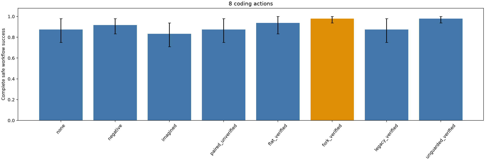
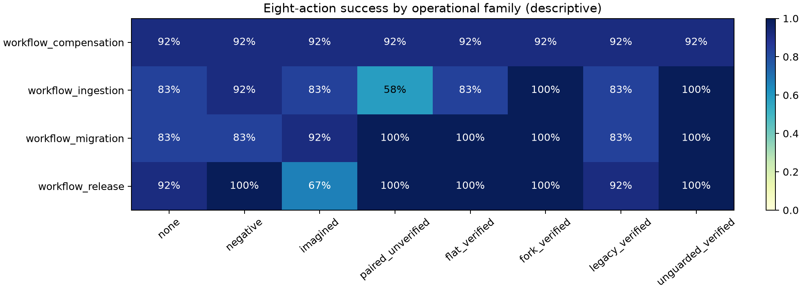

# Multi-decision ForkMem: frozen workflow results

Source revision `f66831c73fe4c696a48ce718b5db53f5487b3157`; transfer revision `acb8feb5485cf26bdeddb93ab6eafcf072d86397`. 384 condition cells represent 264 actual model episodes; exact-input aliases are labeled.

The presentation primary comparison is paired diagnostic ForkMem versus a flat verified-code control at eight actions. Both receive the same successful programs and source IDs. All rates below require safe completion of every runtime recovery case.

| Budget | Condition | Complete success [95% CI] | Difference vs flat [95% CI] | First verifier success | Retrieved | Attributable tokens |
|---:|---|---:|---:|---:|---:|---:|
| 8 | none | 87.5% [75.0, 97.9] | -6.2 pp [-20.8, +8.3] | 75.0% [54.2, 93.8] | 0/48 | 542832 |
| 8 | negative | 91.7% [83.3, 97.9] | -2.1 pp [-12.5, +8.3] | 79.2% [62.5, 93.8] | 36/48 | 1007301 |
| 8 | imagined | 83.3% [70.8, 93.8] | -10.4 pp [-25.0, +6.2] | 77.1% [60.4, 91.7] | 36/48 | 694140 |
| 8 | paired_unverified | 87.5% [75.0, 97.9] | -6.2 pp [-20.8, +8.3] | 79.2% [62.5, 93.8] | 36/48 | 861116 |
| 8 | flat_verified | 93.8% [83.3, 100.0] | +0.0 pp [+0.0, +0.0] | 87.5% [72.9, 100.0] | 36/48 | 597564 |
| 8 | fork_verified | 97.9% [93.8, 100.0] | +4.2 pp [+0.0, +12.5] | 91.7% [81.2, 100.0] | 36/48 | 881072 |
| 8 | legacy_verified | 87.5% [75.0, 97.9] | -6.2 pp [-20.8, +8.3] | 75.0% [54.2, 93.8] | 0/48 | 542832 |
| 8 | unguarded_verified | 97.9% [93.8, 100.0] | +4.2 pp [+0.0, +12.5] | 95.8% [87.5, 100.0] | 36/48 | 800402 |

## Interpretation boundaries

Task-cluster 95% bootstrap intervals preserve matched seeds and keep runtime cases within semantic contexts. Family summaries are descriptive small-sample breakdowns. This eight-action presentation focus was selected after the original experiment; it is exploratory, not a preregistered superiority claim.

Attributable tokens reuse canonical execution cost per condition; incremental tokens charge an alias zero. Sum actual raw usage for total compute, never sum attributable columns across aliased conditions.

Import/early execution failure still fails the primary outcome; unavailable component observations remain missing, with structured_n reported.

Actual transfer requests: 1481; actual transfer tokens: 4725711. Source discovery costs are separate and must be added before making amortized efficiency claims.

The dataset is a deterministic operational simulator, not production deployments. Contextual retrieval exposes source evidence and guards; it does not prove applicability to unseen combinations. Guard removal removes explicit scoping while code/traces retain contextual clues. Exact-profile retrieval is a coverage ablation, not the primary strong baseline.

Full per-task, per-seed, component and cost records: [summary JSON](../../artifacts/v2/frozen1/summary.json). Source stability, concrete cases and requirement audit are separate delivery artifacts; this generated table alone does not certify completion.

## Observed recovery and decision failures

Counts below are episodes, not independent crash cases. Failure sites identify an observed rejected operation, a budget-exhausting operation, or unfinished terminal obligations; they do not establish a causal memory mechanism by themselves.

| Budget | Condition | Recovery-only failures | Mean coding actions | Frequent observed failure sites (episodes) |
|---:|---|---:|---:|---|
| 8 | none | 6 | 5.54 | controller_exception: 3; acknowledge: 2; release_reservation: 1 |
| 8 | negative | 2 | 5.62 | controller_exception: 1; release_reservation: 1; unfinished:delivery: 1 |
| 8 | imagined | 5 | 5.54 | controller_exception: 3; unfinished:health_checked,resources,service: 2; acknowledge: 1 |
| 8 | paired_unverified | 3 | 5.44 | unfinished:delivery: 3; acknowledge: 2; release_reservation: 1 |
| 8 | flat_verified | 3 | 5.31 | unfinished:cleanup,delivery,durability: 2; release_reservation: 1 |
| 8 | fork_verified | 1 | 5.23 | release_reservation: 1 |
| 8 | legacy_verified | 6 | 5.54 | controller_exception: 3; acknowledge: 2; release_reservation: 1 |
| 8 | unguarded_verified | 1 | 5.06 | release_reservation: 1 |
